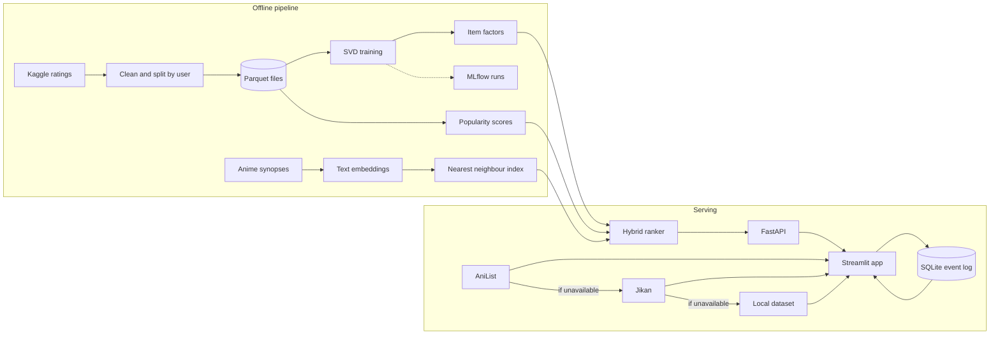
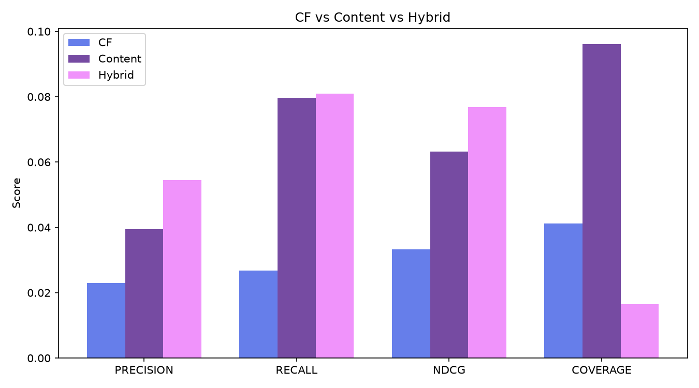

# Anime Recommender

Pick an anime you liked, get ten similar ones. Recommendations come from a
hybrid of collaborative filtering, synopsis-based content similarity and
popularity, trained on 6M+ ratings and served through a FastAPI backend with
a Streamlit front end.

<!-- live demo link goes here -->

## Screenshots

| Recommendations | Browse Catalogue |
|---|---|
|  |  |
| **Browse by Mood** | **Analytics** |
|  |  |

## What it does

The app has six pages:

- **Because You Liked...** search a title, get similar anime from the hybrid model
- **Browse by Mood** genre and mood browsing
- **Browse Catalogue** all 12,294 anime with sort, filter and pagination
- **Airing Now** current season
- **All-Time Greatest** top rated, paginated
- **Analytics** most shown anime and genre coverage, from the app's own event log

## Architecture



## Results

Evaluated on the held-out test split, 200 sampled users, top 10 recommendations,
a rating of 7 or higher counts as relevant. All metric code is written from
scratch in `src/anime_recommender/evaluation/metrics.py` and unit tested against
hand-computed values.

| Model | Precision@10 | Recall@10 | NDCG@10 | Catalogue coverage |
|---|---|---|---|---|
| Collaborative filtering (SVD) | 0.0230 | 0.0268 | 0.0332 | 4.1% |
| Content (synopsis embeddings) | 0.0395 | 0.0796 | 0.0632 | 9.6% |
| **Hybrid** | **0.0545** | **0.0809** | **0.0769** | 1.6% |



Rating prediction for the SVD model: test RMSE 1.1226, MAE 0.8424. Absolute
precision is low because each user has rated well under 1% of the catalogue, so
only a handful of test items can ever count as a hit.

Hybrid weights were chosen from four combinations
(`reports/hybrid_weight_tuning.csv`). Roughly equal weights won on every
accuracy metric.

| alpha (CF) | beta (content) | gamma (popularity) | NDCG@10 | Coverage |
|---|---|---|---|---|
| 0.34 | 0.33 | 0.33 | 0.0769 | 1.6% |
| 0.30 | 0.50 | 0.20 | 0.0653 | 2.4% |
| 0.50 | 0.30 | 0.20 | 0.0635 | 2.9% |
| 0.70 | 0.20 | 0.10 | 0.0459 | 3.5% |

The hybrid is the most accurate but has the lowest coverage, because the
popularity term pulls it toward well-known titles.

## Design decisions

**Why a hybrid.** Collaborative filtering only knows anime that enough users
rated. About 4,000 titles in the catalogue never reach that bar. Synopsis
similarity covers the whole catalogue but ignores what people actually enjoy
together. Popularity is the cheap fallback when both are weak. When an anime
has no CF factors, the CF term is dropped and the other two weights are
renormalised, so "unknown" is never treated as "predicted low".
See `reports/hybrid_design.md`.

**Why Parquet and numpy, not pickle.** Pickle ties data to the Python and
library versions that wrote it and can run arbitrary code when loaded. All
data and model artifacts are now Parquet or `.npy`.

**How the storage problem was solved.** The full `scikit-surprise` model is
about 162 MB on disk and far larger in memory once unpickled, which crashed
the API on a 512 MB host. Item-to-item recommendation only needs the learned
item vectors, so `scripts/export_factors.py` saves just the embeddings and id
maps (about 27 MB, an 84% cut) and the API loads only those. The full model is
kept out of git and tracked with DVC instead.

**Why AniList plus Jikan with a fallback chain.** Both public APIs rate-limit
and go down. Pages try AniList first, then Jikan, then the local dataset, with
retries and exponential backoff on 429 and 5xx responses. Only successful
responses are cached, so an outage is never remembered as "no data". Live data
only supplies posters, scores and browse lists. Ranking stays entirely with the
trained signals.

**Why the API shortlists first.** Scoring all 12k anime per request is slow, so
the API takes nearest neighbours from the CF vectors and the content index,
then applies the full hybrid score to that pool of about 100.

## Tech stack

Python 3.11, pandas, NumPy, scikit-learn, scikit-surprise, sentence-transformers
(`all-MiniLM-L6-v2`), FastAPI, Pydantic, Streamlit, SQLite, MLflow, DVC, pytest,
GitHub Actions, Docker, Render.

## Repo layout

```
app.py                       Streamlit app
src/anime_recommender/
  api/                       FastAPI app and schemas
  data/                      cleaning, split, AniList and Jikan clients, fallback chain, event log
  features/                  content model, similarity
  models/                    SVD training, hybrid scoring, diversity, explanations, confidence
  evaluation/                precision, recall, NDCG written from scratch
scripts/                     one script per pipeline step, train_models.py runs all of them
tests/                       28 tests
reports/                     metrics CSVs, figures, design notes
models/                      exported factors, content index, popularity scores
data/                        raw and processed data (DVC tracked)
```

## Setup

```bash
git clone https://github.com/mayankbungla/Anime_recommender.git
cd Anime_recommender
python -m venv .venv
source .venv/bin/activate        # Windows: .venv\Scripts\activate
pip install -r requirements-dev.txt
```

The artifacts the API and app need are committed, so they run straight away:

```bash
uvicorn anime_recommender.api.main:app --app-dir src --port 8000
streamlit run app.py
```

Copy `.env.example` to `.env` if the API runs somewhere other than
`http://127.0.0.1:8000`.

Run the tests:

```bash
pytest tests/ -v
```

Rebuild everything from the raw data (needs a Kaggle login, the synopsis
fetch is slow and skipped by default):

```bash
python scripts/train_models.py
```

Training runs are logged to MLflow:

```bash
mlflow ui --backend-store-uri sqlite:///mlflow.db
```

Raw data, the training splits and the full SVD model are tracked with DVC. The
configured remote is a local folder, so on a fresh machine use the rebuild
command above instead of `dvc pull`.

Docker (API only):

```bash
docker build -f Dockerfile_api -t anime-api .
docker run -p 8000:8000 anime-api
```

## Limitations

- The CF model is frozen at the Kaggle snapshot, so it knows nothing about newer
  anime. Live pages show new titles, but personalised ranking for them is not
  possible without collecting fresh ratings.
- `/recommend` is item-to-item. The offline evaluation is user-level, so the
  numbers above describe the model, not the live endpoint directly.
- Diversity re-ranking, explanations and confidence scores exist as modules in
  `src/anime_recommender/models/` but are not wired into the API yet.
- The event log is a SQLite file, so it resets whenever the host redeploys.

## Author

Mayank Bungla, [github.com/mayankbungla](https://github.com/mayankbungla)
