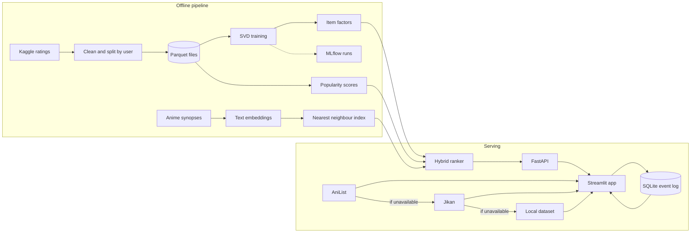

# Architecture

Left side runs once per retrain (`scripts/train_models.py`). Right side runs
on every request. Live sources only supply posters, scores and browse lists,
the ranking itself comes only from the trained signals.
